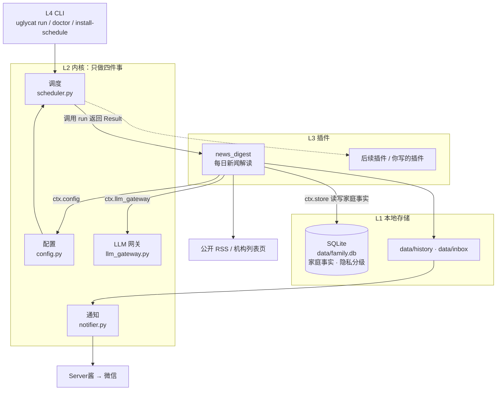

# UglyCat OS

[](https://github.com/uglycatathome/uglycat-os/actions/workflows/ci.yml)


**一个默认跑在你自己电脑上的个人 / 家庭 AI 操作系统**，由内核和多种插件组成。

🧠 **内核负责**：连接 AI、对外发消息、插件之间的通信、配置个人 / 家庭信息让 AI 给出精确建议
（这些数据只存在本地，也不强制要求配置）。

🧩 **插件负责具体功能**：第一个开放的插件是**新闻黑话分析**——重大新闻的提取、筛选、去重、
措辞分析，并把分析结果推送到微信；后续会开放更多我自己在用、真正有用的插件。

**默认跑在本地电脑上**，有需要也可以让你的 AI 部署到云上；跨平台支持
Windows / macOS / Linux，并提供简单的 CLI。

🌱 项目会持续完善，欢迎各位大佬批评指导。

---

## 架构



内核只做四件事，业务全在插件里；插件只通过 `Context`（`ctx.store` / `ctx.llm_gateway` /
`ctx.config`）访问内核，**新增插件不需要改动内核**。细节见
[docs/architecture.md](docs/architecture.md)。

### 底座替你做的三件事

**1）私人信息留在本地，插件读得到但不出本机**

```bash
# 结构化录入
./uglycat fact add --type 家庭 --key 孩子学段 --value "小学二年级" --member 老大
# 自然语言录入：LLM 解析成事实，确认后入库
./uglycat fact note "老二刚上幼儿园，家里每月固定支出大概一万二"
./uglycat fact list
```

事实写进本地 SQLite `data/family.db`，每条带 `public / private / secret` 三级。
`secret` 级事实**不进入任何 LLM 调用**（见 `family_os/kernel/privacy.py`）。
插件通过 `ctx.store` 读取这些事实，所以「知道你家情况」的能力属于底座，
任何插件（包括你后来写的）都自动具备。

**2）插件之间可以协作，但不互相 import**

插件之间只走两种共享通道：

| 通道 | 用途 | 例子 |
|---|---|---|
| `ctx.store` | 共享家庭事实 / 事件 / 决策 | A 插件写入「体检报告结论」，B 插件读来做健康提醒 |
| `data/history/<插件>/` | 共享跑完的产物 | 新闻插件落 `digest.md`，复盘插件读它做周总结 |

这样每个插件都能单独开发、单独升级，互不阻塞。

**3）调度与通知统一收口**

插件只负责返回 `Result`，什么时候跑、发不发微信、发到哪个群，都由内核的调度器与
通知层决定。插件不需要关心定时任务和推送细节。

### 部署方式：默认本地，可选云端

| 方式 | 适合 | 怎么做 |
|---|---|---|
| **本地（默认）** | 个人电脑，数据完全不出本机 | `./install/setup.*` + `./uglycat install-schedule` |
| 云端 / 服务器 | 电脑经常关机，仍想准点收到推送 | 让 AI 按 [docs/deploy-vm.md](docs/deploy-vm.md) 部署到自己的云主机 |

云端只是「换一台机器跑同样的本地程序」，没有额外的云服务依赖，密钥同样只放在 `.env`。

---

## 30 秒安装（交给 AI 执行）

把仓库链接丢给任意编码 AI（Trae / Cursor / Claude Code / Codex），然后说：

> 请按仓库根目录 `AGENTS.md` 安装本项目。

AI 会依次执行 `install/setup.* --check-only`、安装、写入 `.env`，直到
`./uglycat doctor --json` 返回 `{"ok": true}`。

**手动安装**

```bash
# macOS / Linux
./install/setup.sh

# Windows PowerShell
.\install\setup.ps1
```

然后在 `.env` 里填两样东西（都只存在本地）：

```bash
# 1) LLM（必填，任选一个；推荐智谱免费模型 glm-4.7-flash）
ZHIPU_API_KEY=你的Key
# 2) Server酱（想在微信收推送就填，不填则只写本地文件）
SERVERCHAN_SENDKEY=SCT你的SendKey
```

验证并跑一次：

```bash
./uglycat doctor                  # 体检，最后一行应显示「体检通过 ✓」
./uglycat run news_digest --notify  # 立即跑一次：写 data/inbox/ 并推送到微信
```

> Windows 下把 `./uglycat` 换成 `uglycat.cmd`（如 `uglycat.cmd doctor`）。

---

## 插件一：每日新闻解读

这是当前唯一开源的插件，后续插件会按同一套契约陆续加入。

### 每天自动推送

```bash
./uglycat install-schedule --time 08:00   # 注册系统原生定时任务（三平台）
./uglycat install-schedule --uninstall    # 移除
```

定时任务执行的是 `run news_digest --notify`：会跑完整流程并推送 Server酱。
机器睡眠错过 08:00 时，下次执行 `./uglycat catch-up` 会补跑当天。

### 一条推送长什么样

```
📰 每日新闻解读 · 2026-10-30
今日抓取 128 条 · 精选 1 条

### 📌 今日要闻
1. **[9月CPI同比上涨0.4% 涨幅连续三个月收窄](链接)**
   来源：中新网·财经
   涨幅比上月收窄 0.2 个百分点；核心 CPI 同比上涨 0.7%，服务价格环比上涨 0.3%。
   为什么重要：物价读数直接决定利率预期，影响存款利息与房贷成本。

### 🔍 官方措辞解读
【核心判断】「涨幅收窄」与「核心CPI回升」并列：整体压力减轻，但服务类在涨价。
1. 涨幅收窄 → 涨得比上月慢，同样的钱贬值速度在变缓。
2. 核心CPI → 去掉食品和能源后的物价，更能看出真实需求。
3. 同比 → 只和去年同月比，避免被季节性误读。

### ⚠️ 历史措辞变化（同主题对比）
1. 「温和上涨」→【力度变化】本月改为「涨幅收窄」，定调由「回升」转向「低位运行」。
2. 「需求偏弱」→【新提法】改为「有效需求仍待巩固」，语气缓和但指向未变。

### 💡 老百姓一句话建议
💡 别急着囤米面油（食品在降价），服务类该锁价就锁价；有房贷的盯住下一次 LPR 报价。
```

完整示例见 [examples/sample_digest.md](examples/sample_digest.md)。

### 插件内部流程

```
公开 RSS / 机构列表页
        │
        ▼
抓取 → 日期去重 → 内容去重 → 语义去重（LLM）
        │
        ▼
精选（≤3 条，只认国家级发布）
        │
        ▼
措辞提取 → 官方措辞解读 → 历史措辞对比 → 一句话建议
        │
        ▼
data/inbox/*.md  +  Server酱
```

---

## 文档

| 文档 | 内容 |
|---|---|
| [架构](docs/architecture.md) | 四层结构、插件协作方式、数据与隐私边界 |
| [让 AI 帮你装](docs/ai-install.md) | 给 AI 的提示词与检查点 |
| [通知渠道](docs/notify.md) | Server酱 配置、失败排查、自定义渠道 |
| [扩展新闻源](docs/sources.md) | sources.yaml 字段、加源验证流程、给 AI 的模板 |
| [调优提示词](docs/prompts.md) | 用 `prompts/*.md` 持续优化筛选与解读口径 |
| [插件开发](docs/plugin-dev.md) | 插件契约、目录结构、最小示例 |
| [示例输出](examples/sample_digest.md) | 一条推送长什么样 |
| [部署到服务器](docs/deploy-vm.md) | 可选：7×24 常驻（systemd） |

---

## 升级与自定义（不会被覆盖）

```bash
git pull        # 升级到最新：代码与默认规则、默认源清单
```

你自己的东西都放在不会被上游覆盖的位置：

| 你的内容 | 放哪 | 升级时 |
|---|---|---|
| 家庭事实 | `data/family.db` | ✅ `data/` 已被忽略 |
| 自加的 RSS 源 | `family_os/config/sources.local.yaml` | ✅ 自动合并，不冲突 |
| 调优的筛选/解读规则 | `prompts/*.md` | ✅ 不冲突 |
| 密钥 | `.env` | ✅ 不冲突 |

---

## 维护说明

个人开源项目：会持续更新，但不承诺固定的 Issue 响应时间；欢迎直接提 PR（见
[CONTRIBUTING.md](CONTRIBUTING.md)）。如果某一期推送质量明显下降，欢迎带截图开 Issue。

---

## 隐私与合规

- 不内置任何账号、Cookie 或签名逻辑，只访问公开源
- 不保存订阅制媒体正文（配置里已排除财新等来源）
- 家庭事实只存本地 `data/family.db`；`secret` 级事实不进任何 LLM 调用
- 日志默认脱敏（带密钥的 URL 不会落盘）
- 数据目录 `data/`、密钥 `.env` 均被 `.gitignore` 排除

## 许可证

[MIT](LICENSE) —— 随便用、改、商用、再分发，保留版权声明即可。
