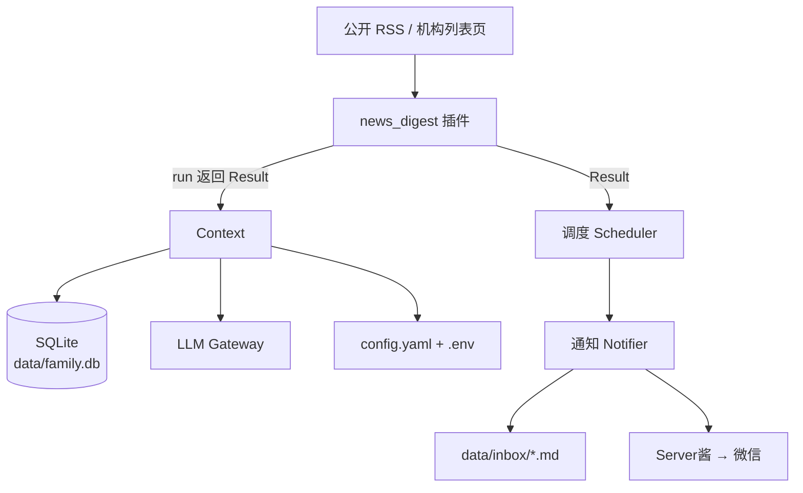
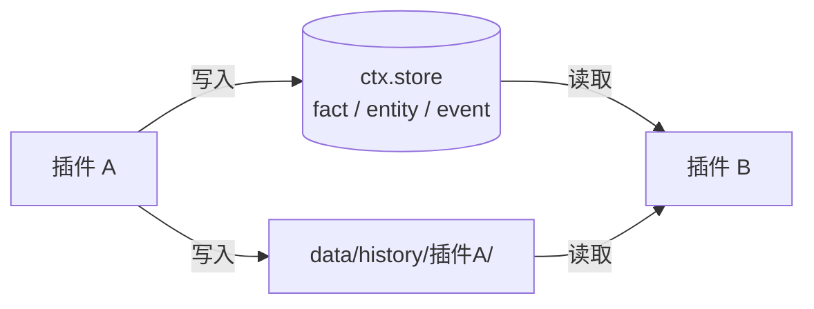

# 架构：内核与插件

一句话：**内核只做四件事（配置、调度、LLM、通知），其他全是插件；插件只通过 `ctx` 访问内核。**

## 四层结构

| 层 | 位置 | 职责 |
|---|---|---|
| L4 入口 | `run.py` + `./uglycat` 启动器 | CLI：`run` / `doctor` / `install-schedule` / `fact` / `ingest` |
| L3 插件 | `family_os/plugins/` | 全部业务逻辑；一个插件一个目录 |
| L2 内核 | `family_os/kernel/` | 配置、调度、LLM 网关、通知、存储、插件发现 |
| L1 存储 | `data/family.db`、`data/history/`、`data/inbox/` | 本地 SQLite 与文件产物，不进仓库 |

## 依赖关系



> 注：Mermaid 的连线文字里不能直接写圆括号，需要时请整段加引号（`-->|"run(ctx)"|`）。

## 内核（L2，`family_os/kernel/`）

| 模块 | 职责 |
|---|---|
| `config.py` | 加载 `config.yaml` + `.env`，产出 `Config` |
| `context.py` | `Context`：插件唯一依赖注入容器（store / config / llm_gateway） |
| `store.py` | SQLite（`data/family.db`）：facts / entities / events / documents / llm_calls |
| `llm_gateway.py` | 统一 LLM 调用：模型路由、降级链、预算、缓存、日志脱敏 |
| `scheduler.py` | APScheduler 按 cron 调插件；`run_plugin()` 供 CLI 手动触发 |
| `notifier.py` | 渠道分发：`file` 与 `serverchan` |
| `discovery.py` | 扫描 `plugins/*/plugin.py`，加载 `Skill` 子类 |
| `privacy.py` | 隐私分级：`secret` 级家庭事实不进入任何 LLM 调用 |
| `doctor.py` / `catch_up.py` / `native_schedule.py` | 体检 / 补跑 / 原生定时任务 |

## 插件（L3，`family_os/plugins/`）

- 一个插件 = 一个目录 + 一个 `plugin.py` + 一个 `Skill` 子类
- `run(ctx) -> Result` 是唯一执行入口
- `register_cli(app)` 可挂子命令
- 插件之间**不直接 import、不直接调用**

## 插件之间如何通信

只通过底座提供的两条共享通道，不产生插件间硬依赖：



| 通道 | 写 | 读 | 典型用法 |
|---|---|---|---|
| `ctx.store` | `store.add_fact` / `add_event` | `store.query_facts` 等 | A 写「体检结论」，B 做健康提醒 |
| 文件产物 | `data/history/<插件>/` | 直接读文件 | 新闻插件落 `digest.md`，复盘插件做周总结 |

好处：任一插件可以单独升级或删除，不影响其他插件；新增插件也不需要改内核。

## 家庭信息与隐私

家庭情况属于**底座能力**，不是某个插件私有的：

```bash
./uglycat fact add --type 家庭 --key 孩子学段 --value "小学二年级" --member 老大
./uglycat fact note "老二刚上幼儿园，家里每月固定支出大概一万二"
```

- 录入后写进 `data/family.db` 的 `facts` 表，字段含 `member`、`sensitivity`
- 插件通过 `ctx.store` 读取，把家庭情况拼进自己的提示词，做个性化分析
- `sensitivity=secret` 的事实只留在本地库，**不会进入任何 LLM 调用**（见 `kernel/privacy.py`）
- 插件不保存家庭数据，只读；删除 `data/family.db` 即彻底清空

| 内容 | 位置 | 是否进仓库 |
|---|---|---|
| 家庭事实 / 成员 | `data/family.db` | 否（`data/` 与 `*.db` 已忽略） |
| 密钥 | `.env` | 否 |
| 每日产物 | `data/history/`、`data/inbox/` | 否 |
| 新闻源清单 | `family_os/config/sources.yaml` | 是（公开源） |

## 本地部署与云端部署

同一套代码，没有云端专有依赖：

- **本地（默认）**：`./uglycat install-schedule --time 08:00` 注册系统原生定时任务
- **云端 / 服务器**：把仓库放到自己的云主机，用 systemd 常驻
  `./uglycat schedule daemon`，步骤见 [deploy-vm.md](deploy-vm.md)

云端与本地一样，密钥只在 `.env`，数据只在 `data/`，不依赖任何第三方托管服务。

## 扩展一个插件

见 [plugin-dev.md](plugin-dev.md)：复制 `examples/hello_plugin`，在 `config.yaml` 注册，
`./uglycat run <name>` 即可运行；不需要改动内核。
